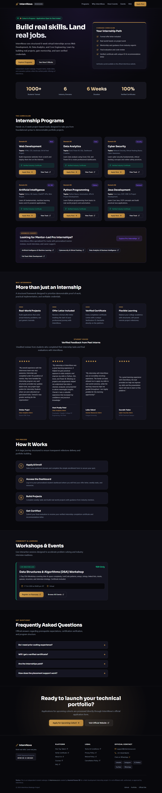
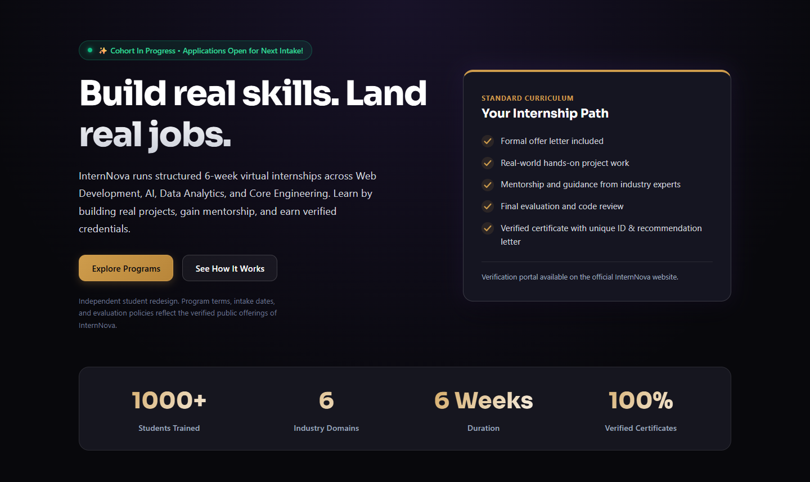
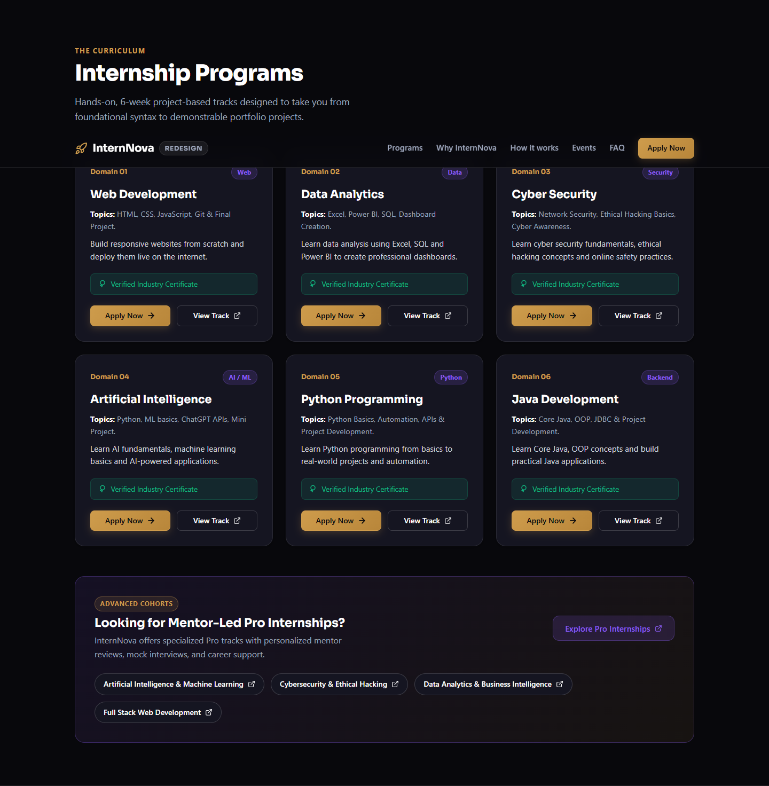
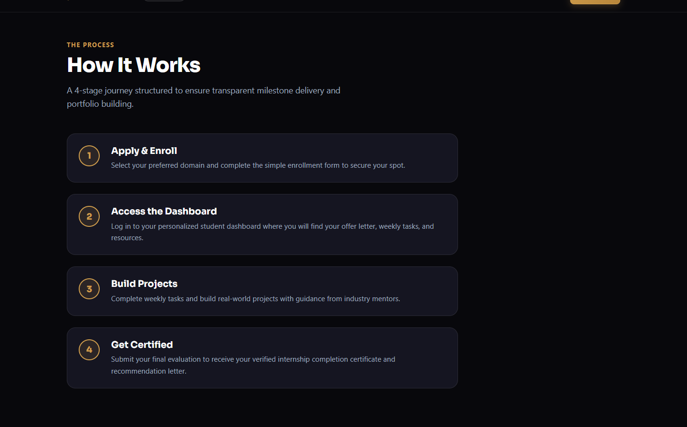
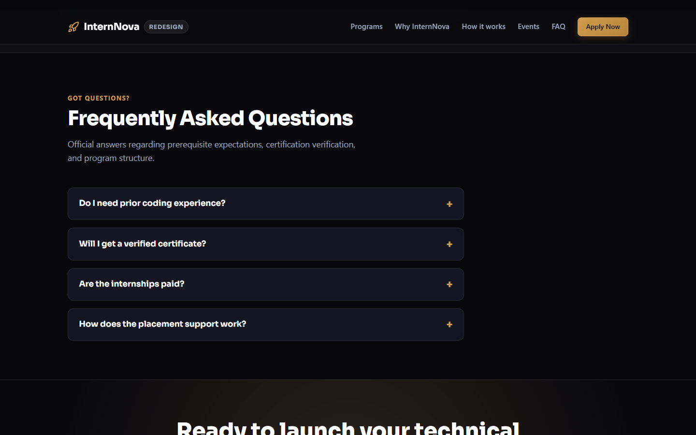
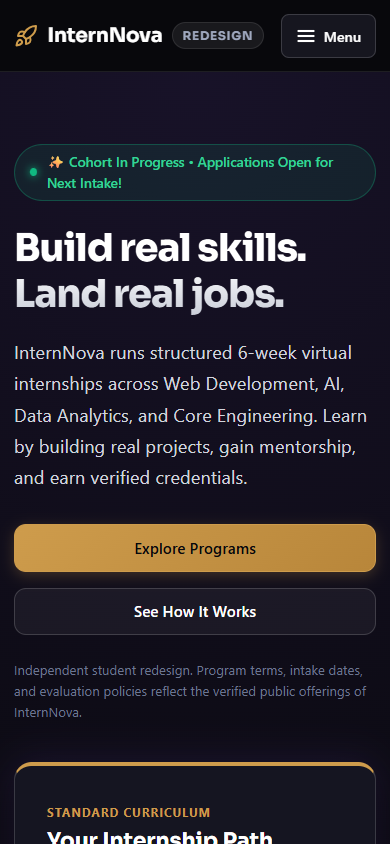
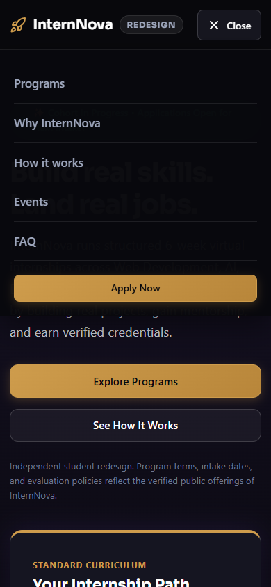

# InternNova Homepage Redesign (Student Project)

> **Disclaimer**: This is an independent student redesign of [internnova.co.in](https://internnova.co.in/) created for a Web Development internship. **This project is not affiliated with, sponsored by, or endorsed by InternNova.** All official programs, registrations, and certifications are managed exclusively by InternNova.

- **Author**: Aravind Kumar GS (B.E. CSE, 2027) · [Portfolio](https://aravindkumar-portfolio.vercel.app) · [GitHub](https://github.com/ARAVINDKUMARGS)
- **Deadline**: 13 October 2026
- **Live URL**: _[To be added after deployment]_
- **Repository**: [https://github.com/ARAVINDKUMARGS/internnova-homepage-redesign](https://github.com/ARAVINDKUMARGS/internnova-homepage-redesign)

---

## 1. Audit Summary

The live website [https://internnova.co.in/](https://internnova.co.in/) was audited in depth using real browser tools. Every piece of content was extracted directly from the verified production build and live database:

- **Verified Programs**:
  - Domain 01: Full Stack & Front-End Web Development (HTML5, CSS3, JS ES6, Git)
  - Domain 02: Data Analytics (Excel, Power BI, SQL, Dashboard Creation)
  - Domain 03: Cyber Security (Network Security, Ethical Hacking Basics)
  - Domain 04: Artificial Intelligence (Python, ML basics, ChatGPT APIs)
  - Domain 05: Python Programming (Automation, OOP, Scripting)
  - Domain 06: Java Development (Core Java, OOP, JDBC)
  - Pro Internships: AI & ML, Cybersecurity, Data Analytics & BI, Full Stack Web
- **Verified Cohort Notice**: "✨ Cohort In Progress • Applications Open for Next Intake!"
- **Verified Application Link**: Real Google Form application link (`https://docs.google.com/forms/d/e/1FAIpQLSd-Bt_lamBujtJ703OGqdhvjmSmJkLLfADzf9YASvs6NZm0ww/viewform`) and track landing pages.
- **Verified Live Event**: 2-Day Data Structures & Algorithms (DSA) Workshop (17 Oct 2026 at 06:00 pm IST, ₹29, Virtual, Razorpay registration link).
- **Verified Student Testimonials**: Real student reviews with exact quotes, names, roles, and colleges (Omkar Pujari, Heet Pradip Patel, Laiba Vakeel, Saurabh Yadav).
- **Verified Brand Tokens**: Dark theme background (`#08080c`, `#16161f`), gold accent (`#ce9c4c`), purple accent (`#8b5cf6`, `#6b21a8`), emerald green (`#10b981`), typography ("Sora", "Inter").
- **Verified Contact & Legal**:
  - Email: `support@internnova.co.in`
  - Phone / WhatsApp: `+91 9534196255`
  - MSME Registration: `UDYAM-BR-24-0054689`
  - Legal Links: Privacy Policy, Terms & Conditions, Refund Policy, Cancellation Policy, Certificate Verification (`/verify`).

---

## 2. Key Features

- **Componentized Modern Architecture**: Modular components located in `src/components/`.
- **Verified Content**: 100% verified program descriptions, application links, FAQs, contact details, and student feedback.
- **Accessibility & UX**:
  - Accessible skip link (`#main`).
  - Native `<details>` & `<summary>` FAQ accordion with keyboard interaction.
  - Mobile menu supporting mouse click, touch, and keyboard (`Enter`, `Space`, `Escape`).
  - Visible focus indicators (`:focus-visible`) for all interactive elements.
  - Sticky navigation header with proper `scroll-padding-top` ensuring anchor targets land below the header.
  - Touch targets calibrated to a minimum of 44px.
  - Prefers-reduced-motion media query support.
- **Zero Horizontal Overflow**: Fully responsive layout validated across 360px, 390px, 768px, 1024px, 1366px, and 1440px viewports.

---

## 3. Project Structure

```
internnova-homepage-redesign/
├── index.html
├── package.json
├── vite.config.js
├── DESIGN_AUDIT.md
├── README.md
├── screenshots/
│   ├── 1-full-desktop-page.png
│   ├── 2-hero.png
│   ├── 3-programs.png
│   ├── 4-how-it-works.png
│   ├── 5-faq-and-footer.png
│   ├── 6-mobile-home.png
│   └── 7-mobile-menu-open.png
└── src/
    ├── App.jsx
    ├── data.js
    ├── styles.css
    └── components/
        ├── Navbar.jsx
        ├── Hero.jsx
        ├── Programs.jsx
        ├── WhyInternNova.jsx
        ├── HowItWorks.jsx
        ├── Events.jsx
        ├── FAQ.jsx
        ├── CallToAction.jsx
        └── Footer.jsx
```

---

## 4. Real Screenshots

All screenshots below were captured from the running application:

### 1. Full Desktop Page (1440px)


### 2. Hero Section


### 3. Programs Grid


### 4. How It Works Timeline


### 5. FAQ & Footer


### 6. Mobile Home View (390px)


### 7. Mobile Menu Open


---

## 5. Verification & Test Checklist

All tests were executed against the live local development server with Chromium:

| Test Item | Viewport / Scope | Status | Notes |
| :--- | :--- | :--- | :--- |
| **No Horizontal Scroll** | 360px | **PASSED** | `scrollWidth === 360px` |
| **No Horizontal Scroll** | 390px | **PASSED** | `scrollWidth === 390px` |
| **No Horizontal Scroll** | 768px | **PASSED** | `scrollWidth === 768px` |
| **No Horizontal Scroll** | 1024px | **PASSED** | `scrollWidth === 1024px` |
| **No Horizontal Scroll** | 1366px | **PASSED** | `scrollWidth === 1366px` |
| **No Horizontal Scroll** | 1440px | **PASSED** | `scrollWidth === 1440px` |
| **Mobile Menu Toggle** | Mouse Click | **PASSED** | Toggles `nav.open` and display styles |
| **Mobile Menu Toggle** | Keyboard (`Enter`, `Escape`) | **PASSED** | Opens on Enter, closes on Escape |
| **FAQ Accordion** | Expand / Collapse | **PASSED** | State toggles cleanly on `<summary>` click |
| **Sticky Header Anchors** | `#programs`, `#why`, `#how`, `#events`, `#faq` | **PASSED** | Lands >= 72px below sticky navbar |
| **Link Integrity** | 53 Links Checked | **PASSED** | 0 broken/empty anchors, valid external protocols |
| **Console Errors** | Browser Runtime | **PASSED** | 0 warnings/errors in console |
| **Production Build** | `npm run build` | **PASSED** | Bundle compiled in 1.37s with zero errors |

---

## 6. How to Run Locally

```bash
# 1. Install dependencies
npm install

# 2. Run local development server
npm run dev
# Server starts at http://localhost:5173/

# 3. Build for production
npm run build

# 4. Preview production build
npm run preview
```

---

## 7. Deployment Instructions (Vercel)

1. Push your repository to GitHub.
2. Go to [Vercel](https://vercel.com/) and click **Add New > Project**.
3. Import the `internnova-homepage-redesign` repository.
4. Set the following build settings:
   - **Framework Preset**: `Vite`
   - **Build Command**: `npm run build`
   - **Output Directory**: `dist`
   - **Install Command**: `npm install`
5. Click **Deploy**.
6. Once deployed, update the `Live URL` and `Repository` links at the top of this `README.md`.
